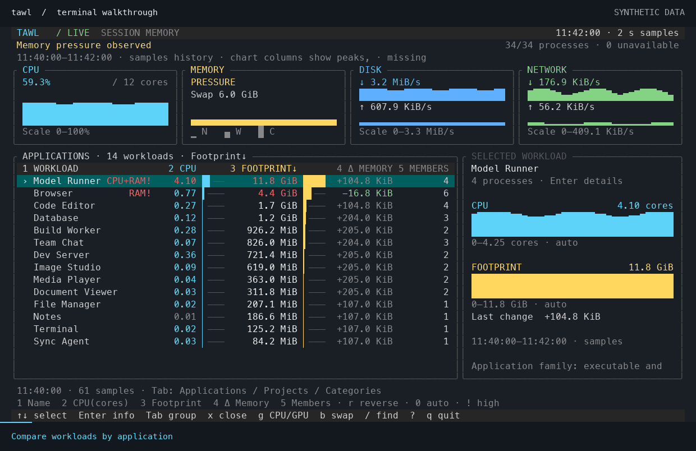

# TAWL

**Terminal Activity & Workload Lens**

See what is loading your Mac. Follow CPU cores, inspect memory pressure, and understand resource use by application or project — from one terminal window.

**macOS 15+ · Apple Silicon & Intel · English / Turkish · MIT**

[Install](#install-with-homebrew) · [See it in action](#see-it-in-action) · [Controls](#a-few-keys-to-get-started) · [Usage guide](docs/usage.md)

<a id="installation"></a>

## Install with Homebrew

The recommended way to install and update TAWL:

```sh
brew tap phalegethon/tawl https://github.com/Phalegethon/tawl
brew install phalegethon/tawl/tawl
tawl
```

No Swift, Python or Node.js toolchain is needed to run the released application.

Already installed?

```sh
brew update
brew upgrade phalegethon/tawl/tawl
```

[Installation, troubleshooting and removal →](docs/installation.md)

## See it in action

### Find the workload behind the load

Start with applications, switch to projects or usage categories, and open the CPU/GPU view when a build or local model gets busy. CPU history is shown per logical core; GPU activity is shown per device when available.



### Review a process. See what changes.

Open the termination panel, check the affected application, and explicitly confirm. TAWL then compares system CPU, memory pressure and swap before and after the request. Export the comparison as a standalone HTML report with charts.


*Both animations use TAWL's actual terminal renderer with synthetic demo data. They are walkthroughs, not performance benchmarks; resource changes alone do not prove causation.*

Prefer still images? [Workload overview](docs/media/tawl-overview.png) · [Before/after comparison](docs/media/tawl-process-review.png)

## A few keys to get started

| Task | Keys |
| --- | --- |
| Select a workload; inspect its processes | `↑` / `↓`, then `Enter` or `i` |
| Group by application, project or usage category | `Tab` |
| Sort by name, CPU, footprint, memory change or members | `1`–`5`; `r` reverses |
| Show/hide CPU cores and GPU activity | `g`; `[` / `]` changes page |
| Investigate memory and swap | `b` |
| Review a process for termination | `x` |
| Reopen the last comparison; export it | `e`, then `d` |
| Search, get help, quit | `/`, `?`, `q` |

Termination always needs a separate confirmation. TAWL rechecks the process identity, protects system and terminal infrastructure, and reports whether the process actually exited. It does not automatically escalate to SIGKILL.

## Reports, recordings and language

```sh
tawl status --sample 3s                  # Quick resource report
tawl status --json                       # Machine-readable output
tawl watch --record session.tawl         # Monitor and record
tawl report session.tawl --last 5m        # Inspect a recording offline
tawl --lang tr                           # Switch to Turkish
```

English is the default. Set `TAWL_LANG=tr` for a persistent shell preference; `--lang en|tr` overrides it. Documentation is in English.

Recordings are opt-in, remain local, and may contain application and project names. Legacy `.nabiz` recordings remain readable. [Full command reference →](docs/usage.md)

## Updates and distribution

`tawl update check` checks for a new stable release. `tawl update` asks before applying it and delegates to Homebrew for Homebrew installations. The live monitor also checks at most once a day in the background; it never installs updates automatically or uploads process measurements. Disable automatic checks with `--no-update-check` or `TAWL_NO_UPDATE_CHECK=1`.

**Current signing status:** release binaries are ad-hoc signed and are **not Developer ID signed or notarized**. Developer ID signing and notarization are deferred. Homebrew is our primary installation route; it does not confer Apple notarization. Browser-downloaded binaries may be blocked by Gatekeeper. No installer disables macOS security protections.

<details>
<summary>Other installation methods</summary>

Prebuilt archives and source builds remain available. Follow the [standalone installation guide](docs/installation.md#alternative-standalone-archive) for architecture selection, checksum verification, installation and updates. Standalone installs use `tawl update`; source checkouts are rebuilt by the developer.

</details>

## Read the numbers correctly

- **CPU:** a process value of `1.00` means one logical core; system CPU is a percentage of total capacity.
- **Memory:** physical footprint is not a guaranteed amount that closing a process will free.
- **Swap:** system-wide measurements cannot identify exact per-process swap ownership or promise when swap will drop.
- **Missing data:** inaccessible measurements are marked explicitly. High usage alone does not establish a bottleneck, leak or unused application.

[Measurement research](docs/research.md) · [Product scope](PRODUCT.md)

## Contribute

Build from source with Xcode, Swift 6 and the macOS SDK:

```sh
make build
make test
./tawl
```

[Distribution and release maintenance](docs/distribution.md) · [How the demos are made](docs/media/README.md)

## License

[MIT](LICENSE).
